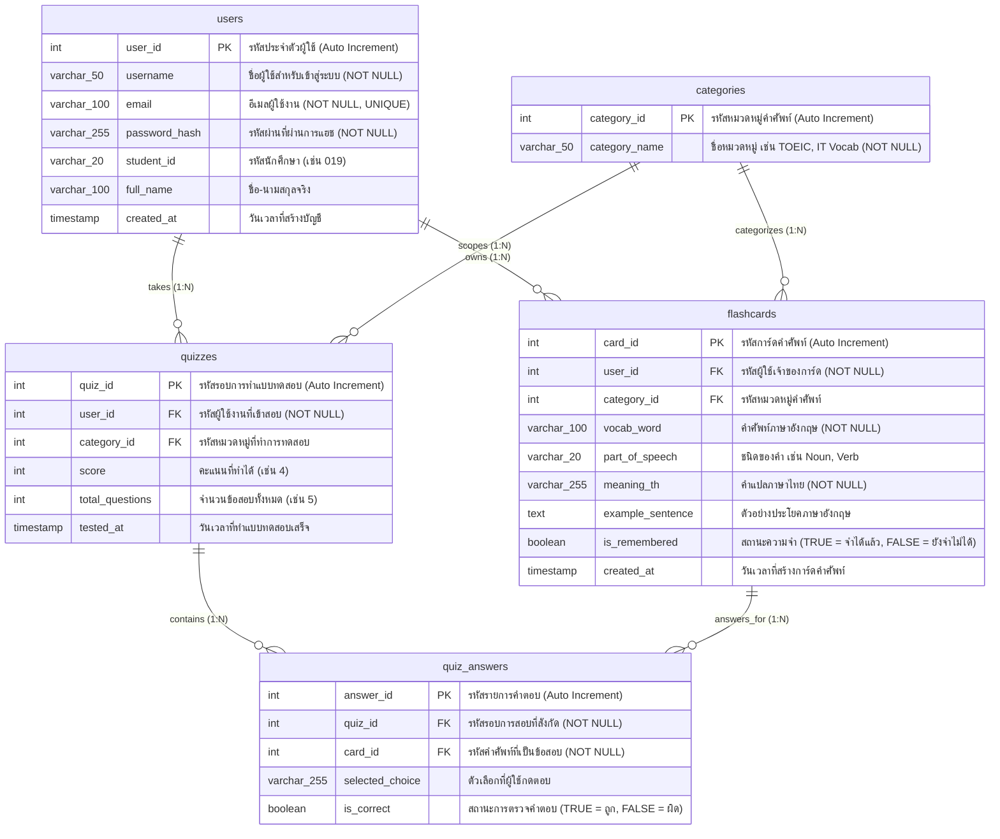

# 12. ออกแบบฐานข้อมูล (ER Diagram) — กำหนดตารางและความสัมพันธ์

เอกสารฉบับนี้กำหนดโครงสร้างฐานข้อมูลเชิงสัมพันธ์ (Relational Database) สำหรับระบบเว็บแอปพลิเคชันคลังคำศัพท์ Flashcard ช่วยจำสอบภาษาอังกฤษ โดยออกแบบให้รองรับการจัดเก็บข้อมูลผู้ใช้ หมวดหมู่คำศัพท์ การ์ดคำศัพท์ พร้อมระบบทำแบบทดสอบและบันทึกประวัติผลคะแนนสอบ (Quizzes & Quiz Answers)

---

### 1. แผนภาพความสัมพันธ์ของเอนทิตี (Mermaid ER Diagram)

---

### 2. พจนานุกรมข้อมูล (Data Dictionary)

#### 2.1 ตารางผู้ใช้งาน (`users`)
เก็บข้อมูลบัญชีผู้ใช้งานระบบ เพื่อใช้ตรวจสอบสิทธิ์และแสดงข้อมูลโปรไฟล์

| ชื่อคอลัมน์ (Column) | ชนิดข้อมูล (Data Type) | คีย์ (Key) | ค่าว่าง (Null) | คำอธิบาย (Description) |
|---|---|---|---|---|
| `user_id` | `INT` | PK | NN (No) | รหัสประจำตัวผู้ใช้งาน (กำหนดค่าอัตโนมัติ Auto Increment) |
| `username` | `VARCHAR(50)` | - | NN (No) | ชื่อผู้ใช้สำหรับล็อกอิน (เช่น `theeradech_019`) |
| `email` | `VARCHAR(100)` | - | NN (No) | ที่อยู่อีเมลผู้ใช้ (เช่น `theeradech_019@vec.go.th`) |
| `password_hash` | `VARCHAR(255)` | - | NN (No) | รหัสผ่านที่ผ่านการแฮชเพื่อความปลอดภัย |
| `student_id` | `VARCHAR(20)` | - | NULL | รหัสนักศึกษา (เช่น `019`) |
| `full_name` | `VARCHAR(100)` | - | NULL | ชื่อ-นามสกุลจริง (เช่น `นายธีรเดช ผกามาด`) |
| `created_at` | `TIMESTAMP` | - | NULL | วันและเวลาที่ลงทะเบียนเข้าใช้งาน |

#### 2.2 ตารางหมวดหมู่คำศัพท์ (`categories`)
เก็บกลุ่มหรือประเภทของคำศัพท์ เช่น หมวด TOEIC, หมวดศัพท์คอมพิวเตอร์และสารสนเทศ

| ชื่อคอลัมน์ (Column) | ชนิดข้อมูล (Data Type) | คีย์ (Key) | ค่าว่าง (Null) | คำอธิบาย (Description) |
|---|---|---|---|---|
| `category_id` | `INT` | PK | NN (No) | รหัสประจำหมวดหมู่คำศัพท์ (Auto Increment) |
| `category_name` | `VARCHAR(50)` | - | NN (No) | ชื่อหมวดหมู่คำศัพท์ (เช่น `TOEIC`, `IT Vocab`) |

#### 2.3 ตารางการ์ดคำศัพท์ (`flashcards`)
เก็บรายการคำศัพท์ภาษาอังกฤษ คำแปล ประโยคตัวอย่าง และสถานะการจดจำ

| ชื่อคอลัมน์ (Column) | ชนิดข้อมูล (Data Type) | คีย์ (Key) | ค่าว่าง (Null) | คำอธิบาย (Description) |
|---|---|---|---|---|
| `card_id` | `INT` | PK | NN (No) | รหัสประจำตัวการ์ดคำศัพท์แต่ละใบ (Auto Increment) |
| `user_id` | `INT` | FK | NN (No) | รหัสผู้ใช้ที่เป็นเจ้าของการ์ดคำศัพท์ (เชื่อมโยง `users.user_id`) |
| `category_id` | `INT` | FK | NULL | รหัสหมวดหมู่ของคำศัพท์ (เชื่อมโยง `categories.category_id`) |
| `vocab_word` | `VARCHAR(100)` | - | NN (No) | คำศัพท์ภาษาอังกฤษ (เช่น `Requirement`, `Implement`, `Deploy`) |
| `part_of_speech` | `VARCHAR(20)` | - | NULL | ชนิดของคำ (เช่น `Noun`, `Verb`, `Adjective`) |
| `meaning_th` | `VARCHAR(255)` | - | NN (No) | คำแปลเป็นภาษาไทย (เช่น `ความต้องการ, เงื่อนไขที่จำเป็น`) |
| `example_sentence` | `TEXT` | - | NULL | ตัวอย่างประโยคประกอบการใช้งานเพื่อความเข้าใจบริบท |
| `is_remembered` | `BOOLEAN` | - | NULL | สถานะความจำ (`TRUE` = จำได้แล้ว, `FALSE` = ยังจำไม่ได้) |
| `created_at` | `TIMESTAMP` | - | NULL | วันและเวลาที่สร้างการ์ดคำศัพท์นี้ |

#### 2.4 ตารางรอบการทำแบบทดสอบ (`quizzes`)
เก็บประวัติรอบการสอบย่อยและคะแนนที่ผู้ใช้ทำได้ในแต่ละรอบ

| ชื่อคอลัมน์ (Column) | ชนิดข้อมูล (Data Type) | คีย์ (Key) | ค่าว่าง (Null) | คำอธิบาย (Description) |
|---|---|---|---|---|
| `quiz_id` | `INT` | PK | NN (No) | รหัสประจำรอบการทำแบบทดสอบ (Auto Increment) |
| `user_id` | `INT` | FK | NN (No) | รหัสผู้ใช้งานที่เข้าทำแบบทดสอบ (เชื่อมโยง `users.user_id`) |
| `category_id` | `INT` | FK | NULL | รหัสหมวดหมู่คำศัพท์ที่เลือกทดสอบ (เชื่อมโยง `categories.category_id`) |
| `score` | `INT` | - | NN (No) | คะแนนที่สอบได้ (เช่น `4`) |
| `total_questions`| `INT` | - | NN (No) | จำนวนข้อสอบทั้งหมดในรอบนั้น (เช่น `5`) |
| `tested_at` | `TIMESTAMP` | - | NULL | วันและเวลาที่ทำแบบทดสอบเสร็จสิ้น |

#### 2.5 ตารางคำตอบรายข้อในแบบทดสอบ (`quiz_answers`)
เก็บรายละเอียดคำตอบแต่ละข้อ เพื่อใช้ตรวจคำตอบ วิเคราะห์คำที่ตอบผิด และดูประวัติย้อนหลัง

| ชื่อคอลัมน์ (Column) | ชนิดข้อมูล (Data Type) | คีย์ (Key) | ค่าว่าง (Null) | คำอธิบาย (Description) |
|---|---|---|---|---|
| `answer_id` | `INT` | PK | NN (No) | รหัสรายการคำตอบ (Auto Increment) |
| `quiz_id` | `INT` | FK | NN (No) | รหัสรอบการสอบที่ข้อนี้สังกัดอยู่ (เชื่อมโยง `quizzes.quiz_id`) |
| `card_id` | `INT` | FK | NN (No) | รหัสการ์ดคำศัพท์ที่เป็นโจทย์ข้อนั้น (เชื่อมโยง `flashcards.card_id`) |
| `selected_choice`| `VARCHAR(255)`| - | NN (No) | ข้อความตัวเลือกที่ผู้ใช้งานเลือกตอบ |
| `is_correct` | `BOOLEAN` | - | NN (No) | ผลการตรวจคำตอบ (`TRUE` = ตอบถูก, `FALSE` = ตอบผิด) |

---

### 3. ความสัมพันธ์ระหว่างตาราง (Table Relationships)

1. **`users` (1) ───< (N) `flashcards` (One-to-Many):**
   * ผู้ใช้งาน 1 คน สามารถสร้างและเป็นเจ้าของการ์ดคำศัพท์ได้หลายใบ
2. **`categories` (1) ───< (N) `flashcards` (One-to-Many):**
   * หมวดหมู่คำศัพท์ 1 หมวดหมู่ สามารถมีการ์ดคำศัพท์บรรจุอยู่ได้หลายใบ
3. **`users` (1) ───< (N) `quizzes` (One-to-Many):**
   * ผู้ใช้งาน 1 คน สามารถเข้าทำแบบทดสอบวัดผลได้หลายรอบ
4. **`categories` (1) ───< (N) `quizzes` (One-to-Many):**
   * หมวดหมู่ 1 หมวดหมู่ สามารถถูกนำมาใช้จัดชุดแบบทดสอบได้หลายครั้ง
5. **`quizzes` (1) ───< (N) `quiz_answers` (One-to-Many):**
   * รอบการสอบ 1 รอบ ประกอบไปด้วยข้อสอบและคำตอบย่อยหลายข้อ (เช่น 5 ข้อ)
6. **`flashcards` (1) ───< (N) `quiz_answers` (One-to-Many):**
   * คำศัพท์ 1 คำ สามารถถูกสุ่มนำไปออกเป็นข้อสอบในประวัติคำตอบได้หลายครั้ง

---

### 4. การเชื่อมโยงระหว่างหน้าจอ UI และฐานข้อมูล (Screen-to-Database Mapping)

| หน้าจอ (Screen) | ตารางฐานข้อมูลที่เกี่ยวข้อง | รายละเอียดการทำงานของคำสั่ง SQL / ข้อมูล |
|---|---|---|
| หน้า 1: Login / Register | `users` | ค้นหาและตรวจสอบสิทธิ์ หรือ `INSERT INTO users` เมื่อสมัครสมาชิกใหม่ |
| หน้า 2: Dashboard | `flashcards`, `quizzes` | สรุปยอดรวมคำศัพท์, คำศัพท์ค้างทบทวน และประวัติคะแนนสอบล่าสุด |
| หน้า 3: ท่องการ์ด | `flashcards`, `categories` | ดึงการ์ดคำศัพท์ และอัปเดตค่า `is_remembered` ตามผลการท่องจำ |
| หน้า 4: เพิ่มการ์ด | `flashcards` | คำสั่ง `INSERT INTO flashcards` จากข้อมูลที่กรอกในฟอร์ม |
| หน้า 5: โปรไฟล์ผู้ใช้ | `users`, `flashcards`, `quizzes` | แสดงข้อมูลผู้ใช้, สถิติการจำคำศัพท์ และประวัติผลการทดสอบ Quiz |
| **หน้า 6: แบบทดสอบ (Quiz)** | `flashcards`, `quizzes`, `quiz_answers` | สุ่มคำศัพท์ 5 คำมาทำเป็นโจทย์ 4 ตัวเลือก เมื่อทำครบ บันทึกรอบสอบลง `quizzes` และคำตอบแต่ละข้อลง `quiz_answers` |
