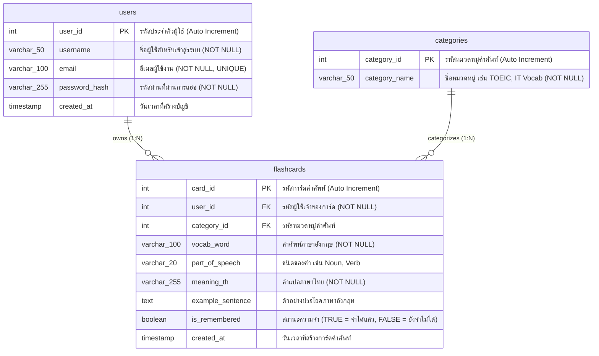

# 12. ออกแบบฐานข้อมูล (ER Diagram) — กำหนดตารางและความสัมพันธ์

เอกสารฉบับนี้กำหนดโครงสร้างฐานข้อมูลเชิงสัมพันธ์ (Relational Database) สำหรับระบบเว็บแอปพลิเคชันคลังคำศัพท์ Flashcard ช่วยจำสอบภาษาอังกฤษ โดยออกแบบให้รองรับการจัดเก็บข้อมูลผู้ใช้ หมวดหมู่คำศัพท์ และการ์ดคำศัพท์ พร้อมบันทึกสถานะการจดจำตามแผนภาพจาก dbdiagram.io

---

### 1. แผนภาพความสัมพันธ์ของเอนทิตี (Mermaid ER Diagram)

---

### 2. พจนานุกรมข้อมูล (Data Dictionary)

#### 2.1 ตารางผู้ใช้งาน (`users`)
เก็บข้อมูลบัญชีผู้ใช้งานระบบ เพื่อใช้ตรวจสอบสิทธิ์และแสดงข้อมูลโปรไฟล์

| ชื่อคอลัมน์ (Column) | ชนิดข้อมูล (Data Type) | คีย์ (Key) | ค่าว่าง (Null) | คำอธิบาย (Description) |
|---|---|---|---|---|
| `user_id` | `INT` | PK | NN (No) | รหัสประจำตัวผู้ใช้งาน (กำหนดค่าอัตโนมัติ Auto Increment) |
| `username` | `VARCHAR(50)` | - | NN (No) | ชื่อผู้ใช้สำหรับล็อกอิน (เช่น `theeradech_019`) |
| `email` | `VARCHAR(100)` | - | NN (No) | ที่อยู่อีเมลผู้ใช้ (เช่น `theeradech_019@vec.go.th`) |
| `password_hash` | `VARCHAR(255)` | - | NN (No) | รหัสผ่านที่ผ่านการแฮชเพื่อความปลอดภัย (เช่น bcrypt) |
| `created_at` | `TIMESTAMP` | - | NULL | วันและเวลาที่ลงทะเบียนเข้าใช้งาน |

#### 2.2 ตารางหมวดหมู่คำศัพท์ (`categories`)
เก็บกลุ่มหรือประเภทของคำศัพท์ เช่น หมวด TOEIC, หมวดศัพท์คอมพิวเตอร์และสารสนเทศ

| ชื่อคอลัมน์ (Column) | ชนิดข้อมูล (Data Type) | คีย์ (Key) | ค่าว่าง (Null) | คำอธิบาย (Description) |
|---|---|---|---|---|
| `category_id` | `INT` | PK | NN (No) | รหัสประจำหมวดหมู่คำศัพท์ (Auto Increment) |
| `category_name` | `VARCHAR(50)` | - | NN (No) | ชื่อหมวดหมู่คำศัพท์ (เช่น `TOEIC`, `IT Vocab`) |

#### 2.3 ตารางการ์ดคำศัพท์ (`flashcards`)
เก็บรายการคำศัพท์ภาษาอังกฤษ คำแปล ประโยคตัวอย่าง และสถานะการจดจำ

| ชื่อคอลัมน์ (Column) | ชนิดข้อมูล (Data Type) | คีย์ (Key) | ค่าว่าง (Null) | คำอธิบาย (Description) |
|---|---|---|---|---|
| `card_id` | `INT` | PK | NN (No) | รหัสประจำตัวการ์ดคำศัพท์แต่ละใบ (Auto Increment) |
| `user_id` | `INT` | FK | NN (No) | รหัสผู้ใช้ที่เป็นเจ้าของการ์ดคำศัพท์ (เชื่อมโยง `users.user_id`) |
| `category_id` | `INT` | FK | NULL | รหัสหมวดหมู่ของคำศัพท์ (เชื่อมโยง `categories.category_id`) |
| `vocab_word` | `VARCHAR(100)` | - | NN (No) | คำศัพท์ภาษาอังกฤษ (เช่น `Requirement`, `Implement`, `Deploy`) |
| `part_of_speech` | `VARCHAR(20)` | - | NULL | ชนิดของคำ (เช่น `Noun`, `Verb`, `Adjective`) |
| `meaning_th` | `VARCHAR(255)` | - | NN (No) | คำแปลเป็นภาษาไทย (เช่น `ความต้องการ, เงื่อนไขที่จำเป็น`) |
| `example_sentence` | `TEXT` | - | NULL | ตัวอย่างประโยคประกอบการใช้งานเพื่อความเข้าใจบริบท |
| `is_remembered` | `BOOLEAN` | - | NULL | สถานะความจำ (`TRUE` = จำได้แล้ว, `FALSE` = ยังจำไม่ได้) |
| `created_at` | `TIMESTAMP` | - | NULL | วันและเวลาที่สร้างการ์ดคำศัพท์นี้ |

---

### 3. ความสัมพันธ์ระหว่างตาราง (Table Relationships)

1. **`users` (1) ───< (N) `flashcards` (One-to-Many):**
   * ผู้ใช้งาน 1 คน สามารถสร้างและเป็นเจ้าของการ์ดคำศัพท์ได้หลายใบ
   * การ์ดคำศัพท์ 1 ใบ จะต้องมีเจ้าของเป็นผู้ใช้งานคนใดคนหนึ่งเท่านั้น (`user_id` ห้ามเป็นค่าว่าง)
2. **`categories` (1) ───< (N) `flashcards` (One-to-Many):**
   * หมวดหมู่คำศัพท์ 1 หมวดหมู่ สามารถมีการ์ดคำศัพท์บรรจุอยู่ได้หลายใบ
   * การ์ดคำศัพท์ 1 ใบ สังกัดอยู่ภายใต้หมวดหมู่ใดหมวดหมู่หนึ่ง

---

### 4. การเชื่อมโยงระหว่างหน้าจอ UI และฐานข้อมูล (Screen-to-Database Mapping)

| หน้าจอ (Screen) | ตารางฐานข้อมูลที่เกี่ยวข้อง | รายละเอียดการทำงานของคำสั่ง SQL / ข้อมูล |
|---|---|---|
| หน้า 1: Login | `users` | ค้นหา `username` หรือ `email` และนำ `password_hash` มาตรวจสอบความถูกต้อง |
| หน้า 2: Dashboard | `flashcards`, `categories` | คำนวณยอดรวม: `COUNT(*)`, ยอดจำได้ `COUNT(is_remembered=TRUE)`, แสดงคำค้างทบทวน `is_remembered=FALSE` |
| หน้า 3: ท่องการ์ด | `flashcards`, `categories` | ดึงการ์ดตามเงื่อนไขตัวกรอง และอัปเดตค่า `is_remembered` เมื่อผู้ใช้กดปุ่มเขียว/แดง |
| หน้า 4: เพิ่มการ์ด | `flashcards` | คำสั่ง `INSERT INTO flashcards` จากข้อมูลที่กรอกในฟอร์ม |
| หน้า 5: โปรไฟล์ผู้ใช้ | `users`, `flashcards` | ดึงข้อมูลจาก `users` และคำนวณเปอร์เซ็นต์ความสำเร็จของคำศัพท์ที่จดจำได้ |
