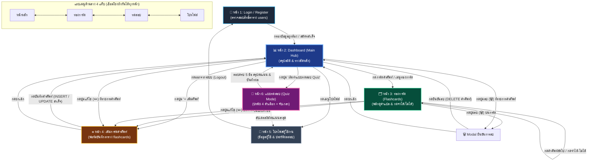

# 11. ออกแบบ Wireframe และ Prototype — ร่างหน้าจอและต้นแบบการทำงาน

เอกสารนี้ระบุรายละเอียดการออกแบบโครงร่างหน้าจอ (Wireframe) และต้นแบบเชิงโต้ตอบ (Interactive Prototype) สำหรับเว็บแอปพลิเคชันคลังคำศัพท์ Flashcard ช่วยจำสอบภาษาอังกฤษ ตามภาพร่างต้นแบบมาตรฐาน 5 หน้าจอ

---

### 1. โครงสร้างหน้าจอและโฟลว์การทำงาน (Screen Flow & Navigation)

```
[หน้า 1: Login]
      │
      ▼ (กดปุ่มเข้าสู่ระบบ)
[หน้า 2: Dashboard] ◄────────────────────────────────────────┐
      │                                                      │
      ├───► [หน้า 3: โหมดท่องการ์ด] ─────────┐                │
      │        (พลิกการ์ด / กดจำได้ / ยังจำไม่ได้)│                │
      │                                       │ (สลับแท็บเมนู)  │
      ├───► [หน้า 4: เพิ่มการ์ดคำศัพท์ใหม่] ────┼────────────────┤
      │        (กรอกข้อมูลคำศัพท์แล้วกดบันทึก)  │                │
      │                                       │                │
      └───► [หน้า 5: โปรไฟล์ผู้ใช้] ──────────┘                │
               (ตรวจสอบบัญชีและสถิติสะสม) ──────────────────────┘
```

---

### 2. รายละเอียดหน้าจอทั้ง 5 หน้า (Screen Specifications)

#### หน้า 1: Login (เข้าสู่ระบบ)
* **หน้าที่หลัก:** ตรวจสอบสิทธิ์ผู้ใช้งาน และเชื่อมโยงข้อมูลกับตาราง `users` (สามารถสลับไปยังฟอร์มสมัครสมาชิก Register ได้)
* **องค์ประกอบหน้าจอ:**
  * สเตตัสบาร์ด้านบน: เวลา `9:41`, สัญญาณ `5G`, แบตเตอรี่ `100%`
  * โลโก้แอปพลิเคชัน: ไอคอนรูปกล่องคำศัพท์สีน้ำเงินพร้อมเส้นบรรทัด
  * หัวข้อหลัก: `Student Vocab`
  * คำบรรยาย: `เข้าสู่ระบบเพื่อทบทวนคลังคำศัพท์เตรียมสอบ`
  * ช่องกรอก 1: `อีเมลหรือชื่อผู้ใช้ (email / username) *` (ตัวอย่างข้อมูล: `theeradech_019@vec.go.th`)
  * ช่องกรอก 2: `รหัสผ่าน (password_hash) *` (แสดงผลจุดรหัสผ่าน `••••••••`)
  * ปุ่มหลัก: `เข้าสู่ระบบ` (สีน้ำเงิน `#2563EB`)
  * ลิงก์ด้านล่าง: `ยังไม่มีบัญชี? สมัครใช้งาน` (กดเพื่อสลับฟอร์มสมัครสมาชิก)
  * แถบเมนูด้านล่าง (Bottom Navigation): มี 2 แท็บ ได้แก่ [เข้าสู่ระบบ (ไฮไลต์), ความช่วยเหลือ] ตรงตาม Wireframe ต้นฉบับ

#### หน้า 2: Dashboard (แผงควบคุมหลัก)
* **หน้าที่หลัก:** สรุปสถิติจำนวนคำศัพท์ทั้งหมด จัดการรายการคำศัพท์ (แก้ไข / ลบ) และแสดงรายการคำศัพท์เร่งด่วนที่ต้องทบทวน
* **องค์ประกอบหน้าจอ:**
  * ส่วนทักทาย: `สวัสดี คุณธีรเดช`, คำบรรยายเป้าหมาย `เป้าหมายสอบ: TOEIC & IT`
  * ปุ่มมุมบนขวา: `+ เพิ่มศัพท์` (เปิดฟอร์มหน้า 4 โหมดเพิ่มคำใหม่)
  * การ์ดสถิติ 3 ช่อง:
    * ช่องที่ 1: ตัวเลข `5` / `คำศัพท์ทั้งหมด`
    * ช่องที่ 2: ตัวเลข `2` / `จำได้แล้ว` (เน้นสีเขียว)
    * ช่องที่ 3: ตัวเลข `3` / `ยังจำไม่ได้` (เน้นสีแดงส้ม)
  * แถบความคืบหน้า: `ความคืบหน้าเป้าหมายคำศัพท์ 40%` พร้อม Progress Bar สีเขียว
  * รายการคำศัพท์ที่ต้องรีบทบทวน (พร้อมปุ่มจัดการ Edit & Delete):
    * รายการที่ 1: `Implement` | ป้าย `TOEIC` | `นำไปปฏิบัติ, ดำเนินการ` | ปุ่ม `[✏️ แก้ไข]` `[🗑️ ลบ]`
    * รายการที่ 2: `Requirement` | ป้าย `TOEIC` | `ความต้องการ, เงื่อนไขที่จำเป็น` | ปุ่ม `[✏️ แก้ไข]` `[🗑️ ลบ]`
    * รายการที่ 3: `Deploy` | ป้าย `IT Vocab` | `นำระบบไปติดตั้ง/ใช้งานจริง` | ปุ่ม `[✏️ แก้ไข]` `[🗑️ ลบ]`
  * แถบเมนูด้านล่าง (Bottom Navigation): 4 แท็บ ได้แก่ [หน้าหลัก (ไฮไลต์), ท่องการ์ด, ทดสอบ, โปรไฟล์]

#### หน้า 3: โหมดท่องการ์ด (Flashcard Study Mode)
* **หน้าที่หลัก:** ทบทวนคำศัพท์โดยการคลิกพลิกการ์ดดูคำแปล กดบันทึกสถานะ `is_remembered` และสามารถแก้ไขหรือลบคำศัพท์ปัจจุบันได้ทันที
* **องค์ประกอบหน้าจอ:**
  * แถบแท็บกรองสถานะ: `[ทั้งหมด (5)]`, `[ยังจำไม่ได้ (3)]` (เลือกอยู่), `[จำได้แล้ว (2)]`
  * แถบเครื่องมือด้านบนการ์ด: ปุ่ม `[✏️ แก้ไขการ์ด]` และ `[🗑️ ลบคำศัพท์]` พร้อมปุ่ม `+ เพิ่มศัพท์`
  * ตัวการ์ดคำศัพท์ Flashcard:
    * ป้ายหมวดหมู่บนการ์ด: `TOEIC`, ชนิดของคำ: `Noun (คำนาม)`
    * คำศัพท์หลัก: `Requirement` (ขนาด 24px ตัวหนา)
    * คำแปลภาษาไทย: `ความต้องการ, เงื่อนไขที่จำเป็น`
    * ตัวอย่างประโยค: `"The client outlined new software requirements."`
    * คำแนะนำ: `คลิกเพื่อพลิกดูคำแปล / เฉลย`
    * ตัวระบุหน้าการ์ด: `การ์ด 2 / 3`
  * ปุ่มกดเลือกสถานะ 2 ปุ่ม:
    * ปุ่มซ้าย: `✕ ยังจำไม่ได้` (สีแดง `#EF4444`)
    * ปุ่มขวา: `✓ จำได้แล้ว` (สีเขียว `#10B981`)
  * ปุ่มนำทาง: `< คำก่อนหน้า` และ `คำถัดไป >`
  * แถบเมนูด้านล่าง: 4 แท็บ ได้แก่ [หน้าหลัก, ท่องการ์ด (ไฮไลต์), ทดสอบ, โปรไฟล์]

#### หน้า 4: เพิ่มและแก้ไขการ์ดคำศัพท์ (Add & Edit Flashcard)
* **หน้าที่หลัก:** ฟอร์มบันทึกข้อมูลคำศัพท์ใหม่ (INSERT) และแก้ไขข้อมูลคำศัพท์เดิม (UPDATE) ลงสู่ตาราง `flashcards`
* **องค์ประกอบหน้าจอ:**
  * หัวข้อหน้า: ปรับเปลี่ยนแบบไดนามิกระหว่าง `เพิ่มการ์ดคำศัพท์ใหม่` หรือ `แก้ไขข้อมูลคำศัพท์`
  * คำบรรยาย: ระบุโหมดการทำงาน เช่น `แก้ไขข้อมูลคำศัพท์และตัวอย่างประโยค`
  * ช่องกรอก 1: `คำศัพท์ภาษาอังกฤษ (vocab_word) *` (ค่าตัวอย่าง: `Requirement`)
  * ช่องกรอก 2: `ชนิดของคำ (part_of_speech)` (ตัวเลือก: Noun, Verb, Adjective, Adverb ฯลฯ)
  * ช่องกรอก 3: `หมวดหมู่คำศัพท์ (category_id) *` (ตัวเลือก: TOEIC, IT Vocab, Everyday ฯลฯ)
  * ช่องกรอก 4: `คำแปลภาษาไทย (meaning_th) *` (ค่า: `ความต้องการ, เงื่อนไขที่จำเป็น`)
  * ช่องกรอก 5: `ตัวอย่างประโยค (example_sentence)` (ค่า: `The user outlined system requirements.`)
  * ช่องเก็บรหัสคำศัพท์ซ่อน: `edit_vocab_id` (สำหรับระบุว่ากำลังแก้ไขคำใด)
  * ปุ่มคำสั่ง:
    * ปุ่มหลัก: `บันทึกคำศัพท์` (โหมดเพิ่ม) หรือ `บันทึกการแก้ไข` (โหมดแก้ไข) (สีน้ำเงิน `#2563EB`)
    * ปุ่มรอง: `ยกเลิก` (กรอบสีเทา กลับไปยังหน้าจอก่อนหน้า)
  * แถบเมนูด้านล่าง: 4 แท็บ ได้แก่ [หน้าหลัก, ท่องการ์ด, ทดสอบ, โปรไฟล์]

#### หน้า 5: โปรไฟล์ผู้ใช้ (User Profile)
* **หน้าที่หลัก:** แสดงข้อมูลบัญชีผู้ใช้งานที่ดึงมาจากตาราง `users` สรุปผลการเรียนรู้ และประวัติคะแนนแบบทดสอบ Quiz
* **องค์ประกอบหน้าจอ:**
  * วงกลมรูปโปรไฟล์: ตัวอักษรย่อ `TP`
  * ข้อมูลส่วนตัว: ชื่อ `นายธีรเดช ผกามาด`, บัญชี `@theeradech_019`
  * ป้ายสถานะ: `นักศึกษา (ID: 019)`
  * การ์ดข้อมูลบัญชี (ตาราง users):
    * รหัสผู้ใช้ (`user_id`): `1`
    * ชื่อผู้ใช้ (`username`): `theeradech_019`
    * อีเมล (`email`): `theeradech_019@vec.go.th`
    * วันที่ลงทะเบียน (`created_at`): `29 ต.ค. 2026`
  * การ์ดสรุปผลการเรียนรู้ & สอบวัดผล:
    * คำศัพท์ในคลังทั้งหมด: `5 ใบ`
    * จดจำสำเร็จแล้ว (`is_remembered`): `2 ใบ (40%)`
    * คะแนนสอบ Quiz ล่าสุด: `4 / 5 (80%)`
    * เป้าหมายระยะนี้: `TOEIC & IT Vocab`
  * ปุ่มคำสั่ง: `แก้ไขข้อมูลส่วนตัว`
  * แถบเมนูด้านล่าง: 4 แท็บ ได้แก่ [หน้าหลัก, ท่องการ์ด, ทดสอบ, โปรไฟล์ (ไฮไลต์)]

#### หน้า 6: แบบทดสอบคำศัพท์ (Quiz Screen) — ฟังก์ชันใหม่
* **หน้าที่หลัก:** ทดสอบประเมินความจำคำศัพท์แบบปรนัย 4 ตัวเลือก จับเวลา และบันทึกคะแนนลงตาราง `quizzes` และ `quiz_answers`
* **องค์ประกอบหน้าจอ:**
  * แถบส่วนหัว: หัวข้อ `แบบทดสอบวัดผล`, หมวดหมู่ `TOEIC & IT Vocab`, และตัวนับเวลาถอยหลัง `⏱ 00:15`
  * แถบความคืบหน้า: ข้อความ `ข้อที่ 1 / 5` พร้อมแถบ Progress Bar
  * การ์ดคำถาม (Question Card):
    * ป้ายกำกับชนิดของคำ (เช่น `Noun (คำนาม)`)
    * คำศัพท์ภาษาอังกฤษตัวใหญ่ (เช่น `Requirement`)
    * ตัวอย่างประโยคพร้อมเว้นวรรคคำศัพท์ (เช่น `"The client outlined clear software _______."`)
  * ตัวเลือกคำตอบ 4 ตัวเลือก (ปรนัย ก, ข, ค, ง):
    * ตัวเลือก ก: `ความต้องการ, เงื่อนไขที่จำเป็น` (ข้อถูก - เปลี่ยนเป็นสีเขียวเมื่อเลือก)
    * ตัวเลือก ข: `นำไปปฏิบัติ, ดำเนินการพัฒนาระบบ` (ข้อผิด - เปลี่ยนเป็นสีแดงหากเลือก)
    * ตัวเลือก ค: `นำระบบไปติดตั้งและใช้งานจริง`
    * ตัวเลือก ง: `กรอบการทำงานหรือโครงสร้างโปรแกรม`
  * ป็อปอัปสรุปคะแนนเมื่อทำครบ 5 ข้อ: แสดงคะแนนที่ได้ (เช่น `4 / 5 (80%)`), ข้อความประเมิน และปุ่มทำซ้ำหรือกลับแดชบอร์ด
  * แถบเมนูด้านล่าง: 4 แท็บ ได้แก่ [หน้าหลัก, ท่องการ์ด, ทดสอบ (ไฮไลต์), โปรไฟล์]

---

### 3. แผนผัง Wireframe โยงเส้นความสัมพันธ์ (Screen Flow Diagram)

แผนผังนี้แสดงเส้นทางการเปลี่ยนผ่านของหน้าจอทั้งหมด (Screen Transitions) และการโต้ตอบของผู้ใช้งาน (User Actions) ที่ทำให้เกิดการเปลี่ยนหน้า:



#### ตารางเมทริกซ์การเปลี่ยนผ่านของหน้าจอ (Screen Transition Matrix)

| หน้าจอต้นทาง (Source) | การกระทำของผู้ใช้ (Trigger Event) | หน้าจอปลายทาง (Target) | คำอธิบายการเปลี่ยนผ่าน |
|---|---|---|---|
| **หน้า 1: Login** | กดปุ่ม "เข้าสู่ระบบ" หรือ "สมัครสมาชิก" | **หน้า 2: Dashboard** | ตรวจสอบรหัสผ่านผ่าน เข้าสู่แดชบอร์ดหลัก |
| **หน้า 2: Dashboard** | กดการ์ดคำศัพท์ หรือแท็บ "ท่องการ์ด" | **หน้า 3: ท่องการ์ด** | เข้าสู่โหมดสลับการ์ดคำศัพท์ |
| **หน้า 2: Dashboard** | กดแบนเนอร์ "🎯 ทำแบบทดสอบ" หรือแท็บ "ทดสอบ" | **หน้า 6: แบบทดสอบ (Quiz)** | เริ่มรอบทดสอบคำศัพท์ 5 ข้อพร้อมจับเวลา |
| **หน้า 2: Dashboard** | กดปุ่ม "เพิ่มศัพท์" หรือไอคอนแก้ไข | **หน้า 4: เพิ่ม/แก้ไขการ์ด** | เปิดฟอร์มกรอกคำศัพท์ใหม่ (โหมด INSERT) |
| **หน้า 2: Dashboard** | กดปุ่ม "แก้ไข (✏️)" ที่แถวคำศัพท์ | **หน้า 4: เพิ่ม/แก้ไขการ์ด** | โหลดข้อมูลคำศัพท์เดิมขึ้นฟอร์ม (โหมด UPDATE) |
| **หน้า 2: Dashboard** | กดปุ่ม "ลบ (🗑️)" ที่แถวคำศัพท์ | **Modal ยืนยันการลบ** | แสดงหน้าต่างยืนยันการลบคำศัพท์ |
| **หน้า 3: ท่องการ์ด** | กดปุ่ม "แก้ไข (✏️)" บนหัวการ์ด | **หน้า 4: เพิ่ม/แก้ไขการ์ด** | โหลดข้อมูลคำศัพท์ปัจจุบันขึ้นฟอร์มเพื่อแก้ไข |
| **หน้า 3: ท่องการ์ด** | กดปุ่ม "ลบ (🗑️)" บนหัวการ์ด | **Modal ยืนยันการลบ** | แสดงหน้าต่างยืนยันการลบคำศัพท์ปัจจุบัน |
| **Modal ยืนยันการลบ** | กดยืนยัน "ลบคำศัพท์" | **หน้า 2: Dashboard / หน้า 3** | ลบข้อมูลออกจากฐานข้อมูล/LocalStorage และคำนวณสถิติใหม่ |
| **หน้า 2: Dashboard** | กดแท็บ "โปรไฟล์" | **หน้า 5: โปรไฟล์** | ดูข้อมูลบัญชีและประวัติผลการเรียนรู้ |
| **หน้า 6: แบบทดสอบ** | ตอบครบ 5 ข้อ แล้วกด "กลับแดชบอร์ด" | **หน้า 2: Dashboard** | บันทึกลง `quizzes` และกลับแดชบอร์ดพร้อมคะแนนใหม่ |
| **หน้า 4: เพิ่ม/แก้ไข** | กดปุ่ม "บันทึก" หรือ "ยกเลิก" | **หน้า 2: Dashboard** | บันทึกการเปลี่ยนแปลง (INSERT/UPDATE) และกลับสู่หน้าหลัก |
| **หน้า 5: โปรไฟล์** | กดปุ่ม "ออกจากระบบ (Logout)" | **หน้า 1: Login** | ล้างเซสชันและกลับสู่หน้าล็อกอิน |

---

### 4. โครงสร้างการแยกโฟลเดอร์ (Folder Structure)

```
devops/
├── index.html                       # Project Portal & Hub (หน้าศูนย์รวมเลือกระหว่าง Prototype และ App)
├── app/                             # โฟลเดอร์ Interactive Hybrid Application (แอปพลิเคชันจริง)
│   ├── index.html                   # ตัวแอปจริง (SPA 6 หน้าจอ พร้อมโหมดทดสอบ Quiz)
│   ├── styles.css                   # สไตล์ของแอป พลิกการ์ด 3D, Quiz Card, Mobile Responsive
│   └── app.js                       # Engine ควบคุม State, LocalStorage, Quiz Engine, Speech Synthesis
├── prototype/                       # โฟลเดอร์ Prototype & Wireframe (โครงร่างสำหรับส่งเล่มรายงาน)
│   ├── wireframe_flow.html          # [NEW] แผนผัง Wireframe โยงเส้นความสัมพันธ์ (Visual Flow SVG)
│   ├── overview_6screens.html       # [NEW] ภาพรวม 6 หน้าจอหลักเรียงกัน (รวมหน้าทดสอบ Quiz)
│   ├── screen1_login.html           # หน้า 1: Login / Register (Bottom Nav 2 เมนู)
│   ├── screen2_dashboard.html       # หน้า 2: Dashboard (มีปุ่มทางลัดเข้าทำแบบทดสอบ)
│   ├── screen3_flashcards.html      # หน้า 3: ท่องการ์ด
│   ├── screen6_quiz.html            # [NEW] หน้า 6: แบบทดสอบวัดผล (Quiz Screen ปรนัย 4 ตัวเลือก)
│   ├── screen4_add_card.html        # หน้า 4: เพิ่มศัพท์
│   ├── screen5_profile.html         # หน้า 5: โปรไฟล์ผู้ใช้
│   └── styles.css                   # สไตล์ชีตสำหรับ Wireframe Mockup
└── 12_Database_ER_Diagram.md ...    # เอกสาร ER Diagram และ Data Dictionary
```

สามารถเปิดไฟล์ `index.html` บนเว็บเบราว์เซอร์ใดก็ได้เพื่อเริ่มทดสอบการทำงานของระบบได้ทันที
